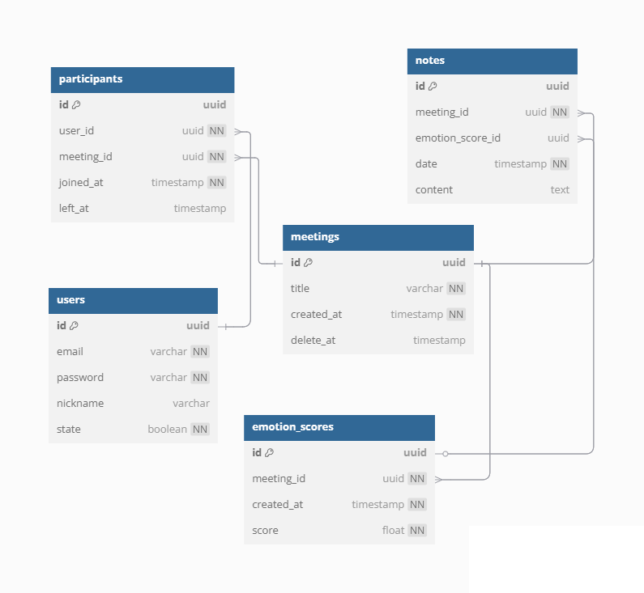

<div align="center">

# 🛠️ FaceMeet Backend (Refactored)

### WebRTC 화상 회의 백엔드

Express + Socket.IO + wrtc(SFU) + MySQL + Prisma

---

</div>

## 📌 소개

이 저장소는 FaceMeet의 백엔드 리팩토링 버전입니다.  
원래는 팀 프로젝트(졸업작품)로 개발되었고, 현재 혼자 다시 설계·구현하고 있습니다.

> 회원가입·로그인(JWT), 회의·회의록 REST API, Socket.IO 시그널링, 서버 중계(SFU) 영상 전달, 실시간 채팅을 담당합니다.  
> 프론트엔드는 화면만 담당하고, DB 접근은 모두 이 서버를 거칩니다.

👉 [📦 FaceMeet Frontend 레포지토리 바로가기](https://github.com/1juyoung/facemeet-refactor-frontend)

---

## 🧱 구조

`routes → controllers → services → Prisma(MySQL)` 순서의 계층 구조입니다.

| 폴더 | 역할 |
| --- | --- |
| `src/routes` | URL과 인증 미들웨어 연결 |
| `src/controllers` | 요청 검증, HTTP 상태 코드 결정 |
| `src/services` | 비즈니스 로직, Prisma로 DB 접근 |
| `src/socket` | 시그널링, SFU, 참가자 상태, 채팅 |
| `prisma/` | 스키마와 마이그레이션 SQL |

---

## ✨ 주요 기능

- 🔐 회원가입·로그인 (bcrypt 해시, JWT)
- 📅 회의 생성·참가·삭제(소프트 삭제), 회의록 CRUD
- 📞 WebRTC 시그널링 + `@roamhq/wrtc` 기반 SFU (TURN 임시 자격 증명 발급)
- 👥 참가자 목록·마이크/카메라 상태 실시간 동기화
- 💬 실시간 채팅 (방별 최근 100개는 메모리에 보관해 늦게 들어온 사람에게 전달)

---

## 💾 ERD (Entity Relationship Diagram)

<div align="center">

</div>

## ⚙️ 기술 스택

| 영역         | 기술                         |
| ------------ | ---------------------------- |
| 언어         | TypeScript, JavaScript       |
| 런타임       | Node.js                      |
| 프레임워크   | Express, Socket.io           |
| 데이터베이스 | MySQL 8, Prisma ORM          |
| 인증         | JWT                          |
| 구조 설계    | 계층형 구조, REST API        |

---

## 🧪 실행 방법

```bash
# 1. 의존성 설치
npm install

# 2. 환경 변수 설정 (.env 파일 생성 후 DATABASE_URL 등 입력)
cp .env.example .env

# 3. DB 테이블 만들기 (MySQL에 빈 facemeet DB가 있어야 함)
npm run db:migrate

# 4. 개발 모드 실행 (ts-node + nodemon)
npx nodemon
```

배포 방법은 [docs/DEPLOY.md](docs/DEPLOY.md)를 참고하세요.
